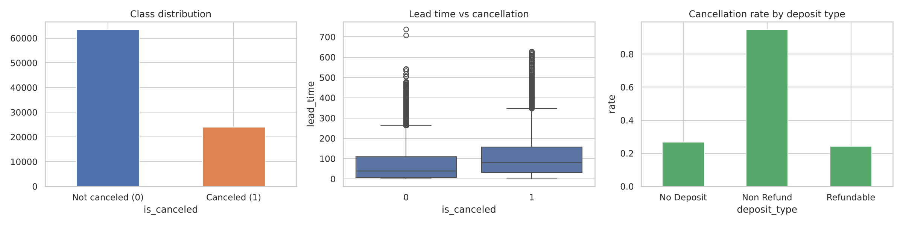
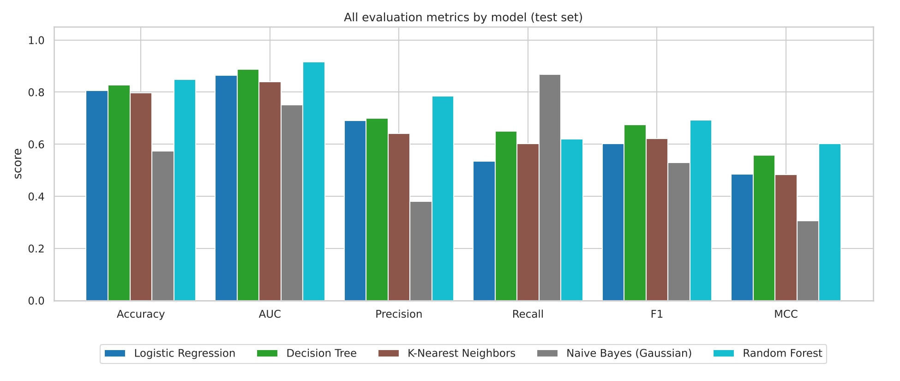
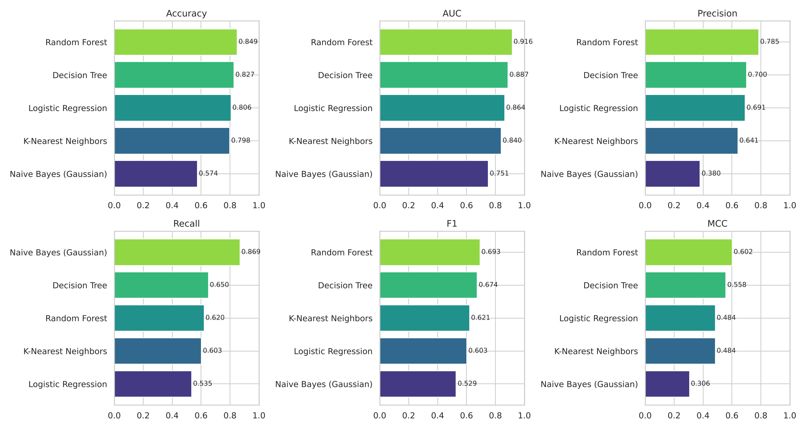
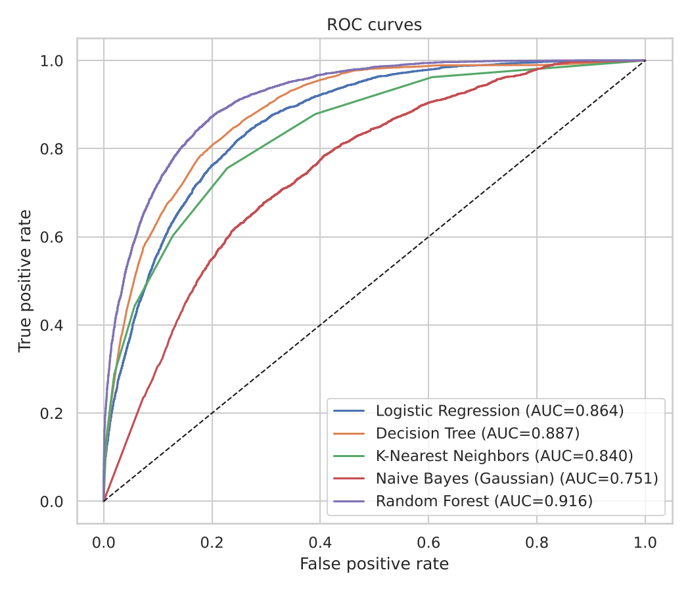
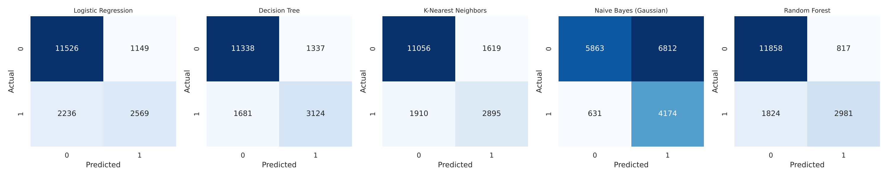

# Hotel Booking Cancellation Prediction – Classification Models

M.Tech (AIML/DSE) · Machine Learning · Assignment 2

## 1. Problem Statement
Booking cancellations cost hotels revenue through empty rooms and last-minute discounting. The goal is to predict, from information known about a reservation, whether it will be **cancelled** (`is_canceled = 1`) or honoured (`0`). This is a **binary classification** problem. Five classifiers (Logistic Regression, Decision Tree, K-Nearest Neighbors, Gaussian Naive Bayes, Random Forest) are trained on the same data and compared with Accuracy, AUC, Precision, Recall, F1 and MCC.

## 2. Dataset Description  [1 mark]
| Item | Detail |
|---|---|
| Source | *Hotel Booking Demand* dataset (Antonio, Almeida & Nunes, 2019), Kaggle: `jessemostipak/hotel-booking-demand` |
| Why chosen | Real-world business problem, large (>87k rows), mix of numeric and categorical features, real missing values and duplicates, and a moderately imbalanced target – it exercises every preprocessing step the assignment asks for. |
| Raw size | 119,390 rows × 32 columns (City Hotel + Resort Hotel, 2015–2017) |
| Target | `is_canceled` (0 = not cancelled, 1 = cancelled) |
| Features used | 28 (17 numeric, 11 categorical) – e.g. `lead_time`, `adr`, `deposit_type`, `market_segment`, `country`, `previous_cancellations`, `total_of_special_requests`, `customer_type` |
| Assignment minimums | ≥12 features ✔ (28) · ≥1,000 rows ✔ (87,396 after cleaning) |

**Class distribution.** Raw: 62.96 % not cancelled / 37.04 % cancelled. After duplicate removal: **72.51 % / 27.49 %** – moderately imbalanced, so a stratified split is used and Accuracy alone is not trusted (Precision, Recall, F1, AUC and MCC are also reported).



## 3. Preprocessing
1. **Missing values** – `children` (4) → median imputation; `country` (488) → category `Unknown`; `agent` (16,340, no agent used) → category `no_agent`; `company` (94 % missing) → column dropped.
2. **Duplicates** – 31,994 exact duplicate rows removed (119,390 → 87,396).
3. **Data leakage removed** – `reservation_status` and `reservation_status_date` are dropped: `reservation_status` ∈ {Canceled, No-Show} is exactly `is_canceled = 1`, so keeping it gives a fake ~100 % score.
4. **Encoding** – One-Hot encoding of the 11 categorical features; categories with < 50 training occurrences (rare countries/agents) are grouped into an "infrequent" bucket, and unseen categories at test time are handled safely.
5. **Scaling** – `StandardScaler` on the 17 numeric features (needed by Logistic Regression, KNN, Naive Bayes).
6. **Split** – 80:20 `train_test_split`, `stratify=y`, `random_state=42` → 69,916 train / 17,480 test, both with 27.49 % positives.
7. **No leakage from preprocessing** – imputer, scaler and encoder live inside a scikit-learn `Pipeline` and are fitted on the training set only.

## 4. Models and Configurations
| Model | Configuration |
|---|---|
| Logistic Regression | `max_iter=1000`, L2, default C=1 |
| Decision Tree | `max_depth=12`, `min_samples_leaf=10` (limits over-fitting) |
| K-Nearest Neighbors | `n_neighbors=7`, Euclidean |
| Naive Bayes | `GaussianNB` (default smoothing) |
| Random Forest | `n_estimators=200`, `min_samples_leaf=2` |

All use `random_state=42` where applicable. No hyper-parameter search was run; values are sensible fixed settings.

## 5. Results (20 % hold-out test set, 17,480 rows)

| ML Model | Accuracy | AUC | Precision | Recall | F1 | MCC |
|:--|--:|--:|--:|--:|--:|--:|
| Logistic Regression | 0.8064 | 0.8641 | 0.6910 | 0.5347 | 0.6028 | 0.4844 |
| Decision Tree | 0.8273 | 0.8872 | 0.7003 | 0.6502 | 0.6743 | 0.5578 |
| K-Nearest Neighbors | 0.7981 | 0.8398 | 0.6413 | 0.6025 | 0.6213 | 0.4843 |
| Naive Bayes (Gaussian) | 0.5742 | 0.7507 | 0.3799 | 0.8687 | 0.5287 | 0.3060 |
| **Random Forest (Ensemble)** | **0.8489** | **0.9156** | **0.7849** | 0.6204 | **0.6930** | **0.6019** |

### Visualisations  [2 marks]





## 6. Observations  [3 marks]
| Model | Observation |
|---|---|
| Logistic Regression | Solid linear baseline (Acc 0.806, AUC 0.864) but the lowest recall of the group (0.535): it misses almost half of the real cancellations. The decision boundary is probably non-linear (e.g. interaction of `deposit_type`, `lead_time`, `market_segment`), which a linear model cannot capture. |
| Decision Tree | Clearly better than the linear model (F1 0.674, MCC 0.558) and the best recall among the "balanced" models (0.650). It captures non-linear rules and interactions and is easy to interpret, but a single tree is high-variance and its AUC (0.887) trails the forest. |
| K-Nearest Neighbors | Accuracy 0.798 / AUC 0.840, similar to Logistic Regression. Distance in ~100 one-hot + scaled dimensions is not very meaningful, so neighbours are noisy; it is also the slowest at prediction time. |
| Naive Bayes | Worst model (Acc 0.574, MCC 0.306, Precision 0.380) with the highest recall (0.869): it labels far too many bookings as "cancelled". The Gaussian and feature-independence assumptions are violated by one-hot columns and correlated features (e.g. `market_segment` / `distribution_channel`), giving badly calibrated probabilities. It would only be useful if catching every cancellation mattered far more than false alarms. |
| Random Forest | **Best overall** – highest Accuracy (0.849), AUC (0.916), Precision (0.785), F1 (0.693) and MCC (0.602). Averaging 200 de-correlated trees cuts the variance of a single tree. Its recall (0.620) is below the tree's, i.e. it is more conservative; the decision threshold could be lowered if recall is preferred. |

**Overall.** Ranking by MCC (the most reliable single number under class imbalance): Random Forest > Decision Tree > Logistic Regression ≈ KNN > Naive Bayes. Tree-based models win, which indicates cancellation behaviour is driven by non-linear rules. All models find recall harder than precision because only ~27 % of bookings are cancellations. Note that 31,994 duplicates were removed; keeping them inflates scores because identical rows land in both train and test.

## 7. How to Run
```bash
git clone <YOUR_GITHUB_REPO_URL>
cd hotel-cancellation-ml
pip install -r requirements.txt
python main.py          # ~30 s; prints metrics and writes results/*.png, results/metrics.csv, data/test_data.csv
```
Repository layout:
```
hotel-cancellation-ml/
├── main.py                    # entry point: runs everything
├── requirements.txt
├── README.md
├── .gitignore
├── src/
│   ├── config.py              # seed, paths, dropped columns
│   ├── data_preprocessing.py  # load, clean, split, preprocessing transformer
│   ├── models.py              # the 5 classifiers
│   └── evaluation.py          # metrics + plots
├── data/
│   ├── hotel_bookings.csv     # raw dataset
│   └── test_data.csv          # 20% hold-out test set
└── results/                   # metrics.csv, figures, run_log.txt
```

## 8. GitHub Repository Link  [2 marks]
`<PASTE YOUR GITHUB REPO LINK HERE>`

## 9. BITS Virtual Lab Execution Screenshot  [2 marks]
`<INSERT SCREENSHOT HERE>`
